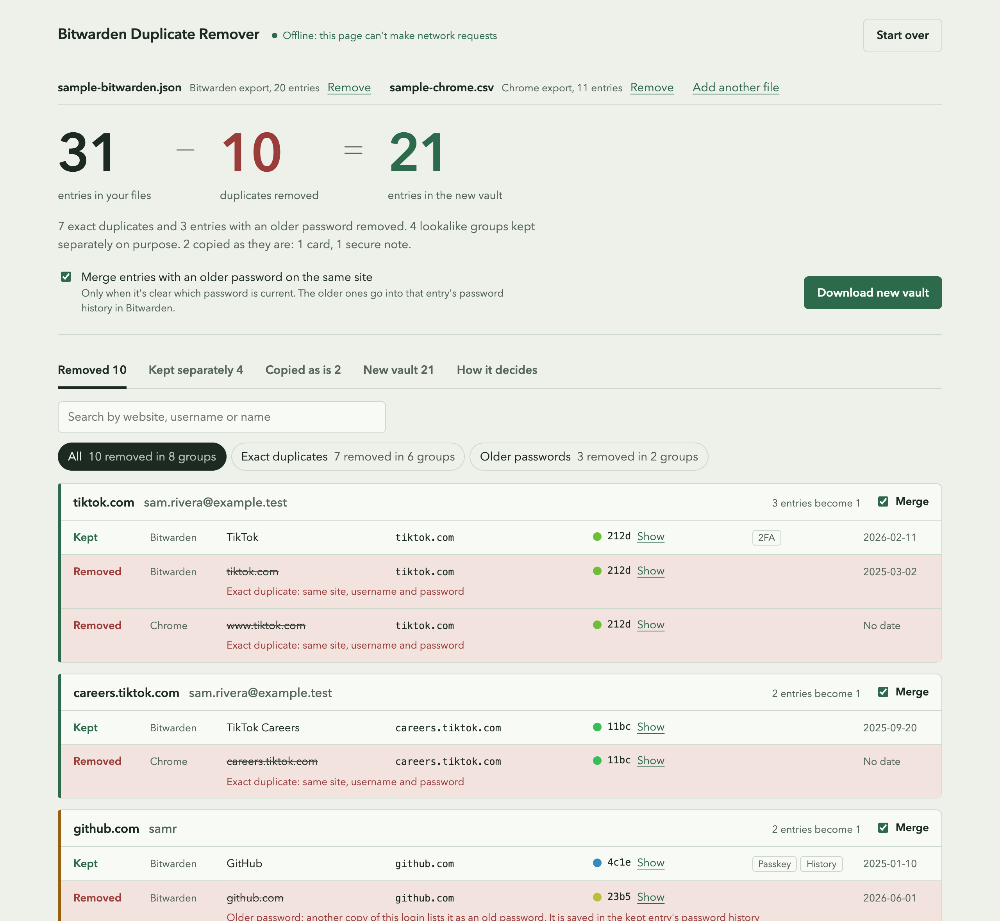
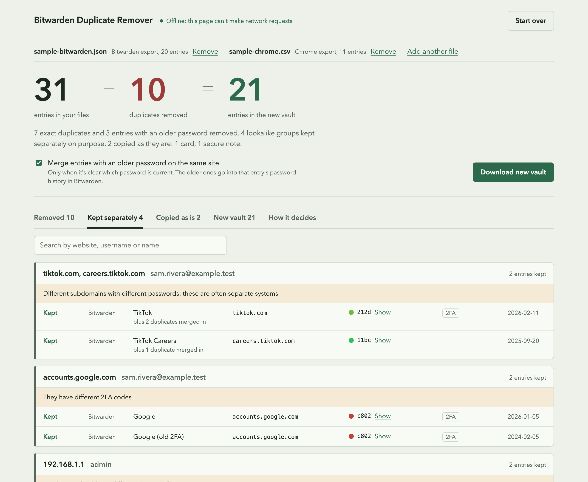
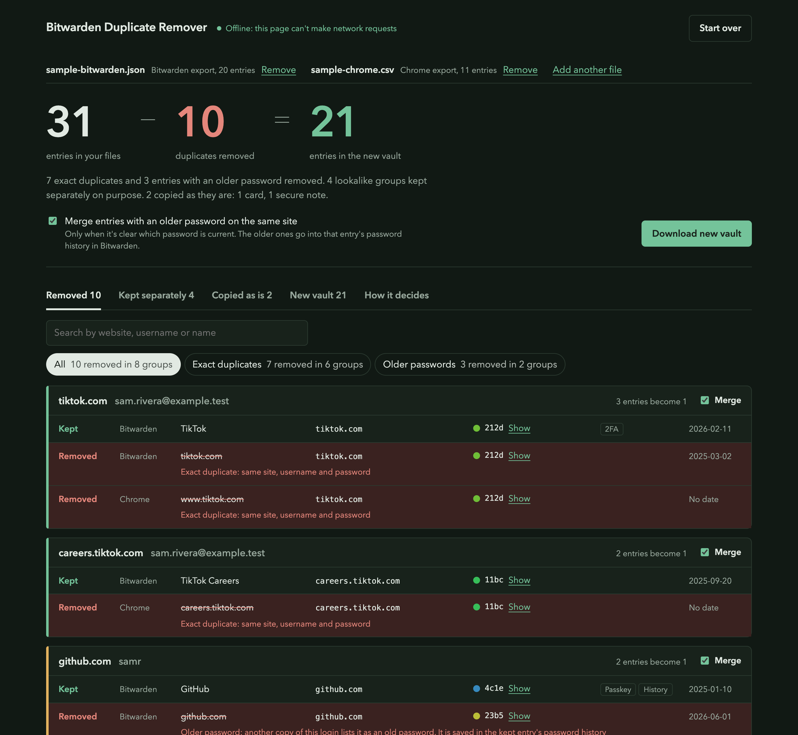

# Bitwarden Duplicate Remover

Remove and merge duplicate passwords in Bitwarden. This tool combines your Bitwarden export with your Chrome passwords, shows every duplicate it found and why, and gives you one clean file to import back into Bitwarden.

Everything runs inside your browser. Nothing is uploaded, and the page is blocked from making any network request.

**Use it online:** https://shyam-makwana.github.io/bitwarden-duplicate-remover/

**Or offline:** download this repository as a ZIP (green "Code" button, then "Download ZIP"), unzip it, and open `index.html` in Chrome, Edge or Firefox.



## Why this exists

If you save passwords in both Chrome and Bitwarden, or you imported the same passwords more than once, you end up with several copies of the same login. One for `tiktok.com`, one for `www.tiktok.com`, one from Chrome, and so on. Bitwarden has no built-in way to find and merge them, and going through hundreds of entries by hand takes hours.

## How to use it

1. **Back up your vault.** In Bitwarden, go to Tools > Export vault and save a `.json (Encrypted)` copy somewhere safe.
2. **Export again as plain `.json`.** This is the file the tool reads.
3. **Optional: export your Chrome passwords.** Open `chrome://password-manager/settings` and choose Export passwords. You get a `.csv` file.
4. **Open the tool and drop both files on the page.**
5. **Look through the results.** Every removed entry shows which entry it was merged into and why. Untick "Merge" on any group you disagree with.
6. **Click "Download new vault".**
7. **Try it in a test account first.** Create a second, empty Bitwarden account and import the file there (Tools > Import data > "Bitwarden (json)"). When it looks right, go to your main account, clear it with Settings > Vault > Purge vault, and import the same file.
8. **Delete the plain `.json` and `.csv` exports** when you're done. They contain all your passwords unencrypted.

To see how it works without touching your own passwords, use the two files in the `sample` folder.

## What counts as a duplicate

Two entries are the same login when they have the **same website** and the **same username**. Capital letters in the username don't matter.

**Same website** means the same main domain. `www.tiktok.com`, `tiktok.com` and `careers.tiktok.com` all count as `tiktok.com`. Hosting platforms are handled properly, so `foo.github.io` and `bar.github.io` stay different sites. This uses the Public Suffix List, the same list browsers use.

**Same password too:** the entries are merged. The entry that is kept gets every web address, note, custom field, 2FA code and passkey from the copies, so nothing is lost.

**Different password:** the tool only merges when it can tell which password is current:

- another copy already lists the other password in its password history, or
- one password was set on a real date after the other one already existed, or
- Chrome and a dated Bitwarden entry both have the same password.

The older passwords are saved in the kept entry's password history, so you can still find them in Bitwarden. If none of these apply, nothing is guessed: both entries are kept and listed under "Kept separately".

**No web address saved:** some logins only have a name. If the name is a domain, like `appleid.apple.com`, it's used to match the entry and is saved as its web address in the new file. A login can also join another entry that has the exact same name, username and password.

**Never merged:**

- the same password on different websites
- entries with different 2FA codes, or more than one passkey
- different subdomains with different passwords, which are often separate systems
- local network addresses like `192.168.1.1`
- entries without a username that have different passwords

**Copied over unchanged:** cards, identities, secure notes, SSH keys, organization items, items in the trash, and logins with no website at all.



## Privacy

- The page has a Content-Security-Policy that blocks every network request: no uploads, no analytics, no fonts or scripts from other sites. Even if the code tried to send something, the browser would refuse.
- There are no dependencies and no build step. All the code is in `index.html`, `styles.css` and the `src` folder, so you can read it yourself.
- To check it yourself, turn off Wi-Fi before opening the page. It works exactly the same.

## Supported files

- **Bitwarden:** the unencrypted `.json` export. The encrypted export and the Bitwarden `.csv` export are rejected on purpose, because the CSV leaves out passkeys, cards, identities and password history, and re-importing it would lose them.
- **Chrome:** the password `.csv` export. Edge and Brave use the same format. Firefox and Safari password exports are read too.

You can load several files at once, for example two Bitwarden exports and a Chrome export.

## Good to know

- Bitwarden exports don't include file attachments. Purging your vault deletes them, so save any attachments first.
- Items shared through an organization aren't in your personal export and aren't touched.
- If a login fails after importing, open that entry in Bitwarden and check Password history. The other password is there.
- Imported items all get the import time as their date. The tool recognizes these and doesn't treat them as "newer". They show as "Imported".

## FAQ

**How do I remove duplicate passwords in Bitwarden?**
Export your vault as `.json`, drop it on this page, review the results, download the cleaned file and import it into an empty vault. Bitwarden doesn't have a duplicate finder of its own.

**Can I move my Chrome passwords into Bitwarden without creating duplicates?**
Yes. Load your Chrome `.csv` together with your Bitwarden `.json`. Logins that exist in both are merged into one.

**Does it delete anything?**
It never changes your files. It creates a new file. Every removed entry is shown with a reason first, and its web addresses, notes, 2FA codes and passkeys move to the entry that is kept.

**Is it safe to use with my real passwords?**
The page can't make network requests (see Privacy above), and you can run it completely offline from your own computer.

**Does it work with 1Password, LastPass or KeePass?**
Not directly. Import those into Bitwarden first, export from Bitwarden as `.json`, then use this tool.

<details>
<summary>Dark mode</summary>



</details>

## For developers

Tests need Node 22 or newer, with nothing to install:

```
npm test
```

| File | What it does |
|---|---|
| `index.html`, `styles.css` | The page |
| `src/parse.js` | Reads Bitwarden JSON and browser CSV files |
| `src/site.js` | Works out the website of each login, using `src/psl-data.js` |
| `src/dedupe.js` | Finds and merges duplicates |
| `src/render.js`, `src/app.js` | The interface |
| `test/` | Unit tests and a 2,000-entry end-to-end test |
| `sample/` | Fake exports for trying the tool |

To refresh the Public Suffix List: `npm run update-psl`

Issues and pull requests are welcome.

## License

[MIT](LICENSE)
